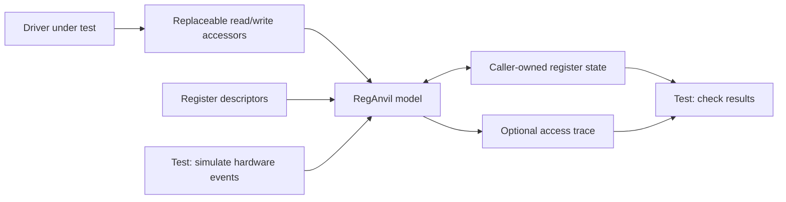
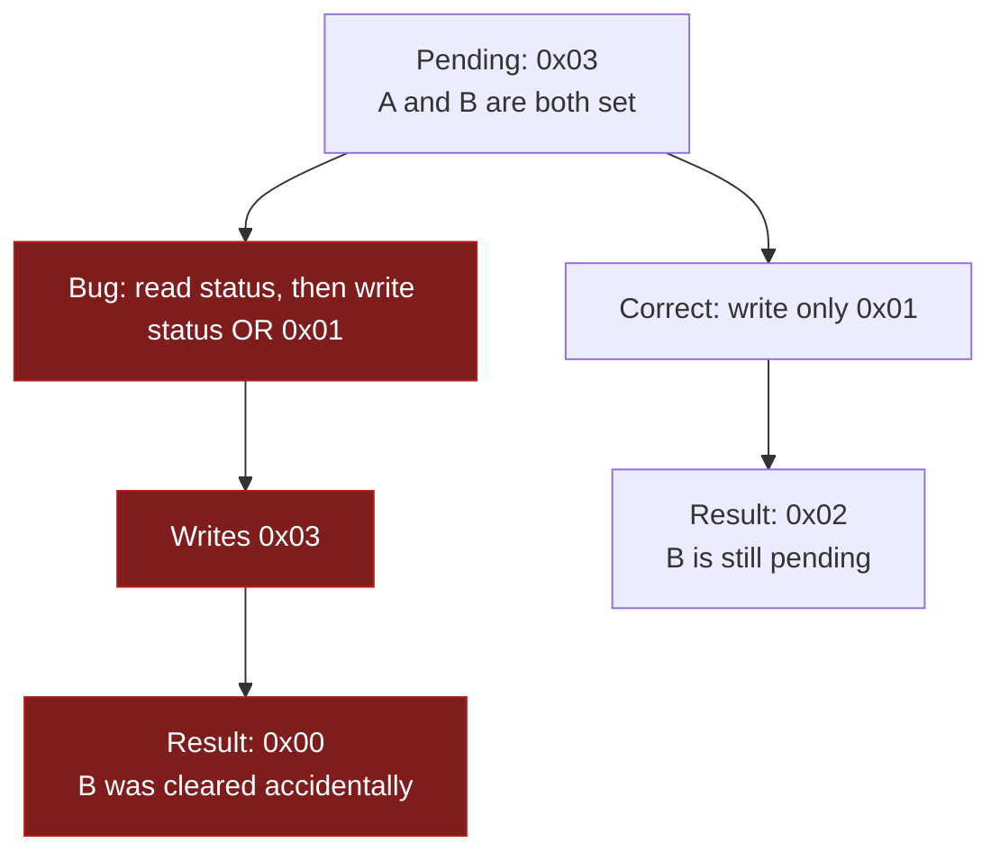
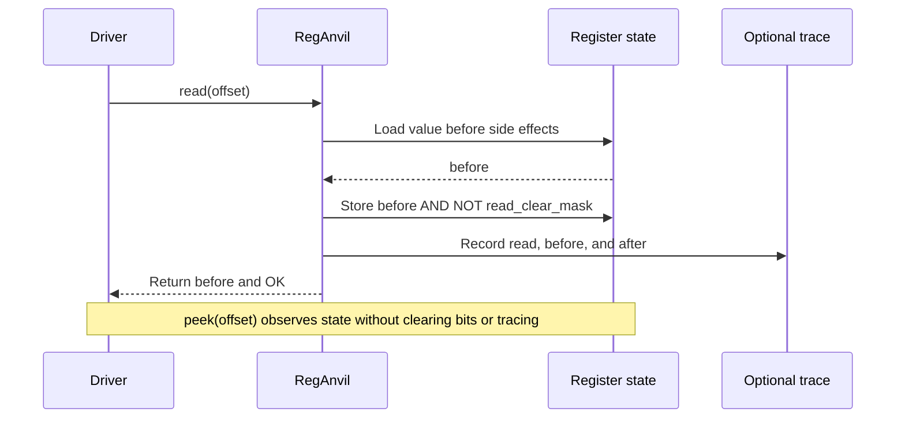

# RegAnvil

**Hardware register behavior. Plain C tests.**

RegAnvil is a small C99 library that lets you test a hardware driver without a board. Describe the device's 32-bit registers, connect the driver's read/write functions, and check that the driver handles the register rules correctly.

The model keeps real state between accesses: read-only bits resist writes, write-one-to-clear flags clear only when acknowledged, and read-clear bits disappear after a read. Optional tracing shows exactly what the driver read or wrote and how each register changed.

**Version:** 0.1.0 · **Language:** C99 · **License:** [MIT](LICENSE)

[Source](https://github.com/MeysamResan/mxs-reganvil) · [Releases](https://github.com/MeysamResan/mxs-reganvil/releases) · [CI runs](https://github.com/MeysamResan/mxs-reganvil/actions/workflows/ci.yml)

- One public header and one C source file.
- Caller-owned storage; no heap allocation, operating-system calls, runtime dependencies, or mutable global state.
- Explicit errors and failure preservation; no printing, process termination, or hidden recovery inside the library.
- Native tests, a realistic RP2040 driver fixture, CMake integration, and a relocatable installed package.

## Contents

- [How it works](#how-it-works)
- [Quick start](#quick-start)
- [A complete C example](#a-complete-c-example)
- [Connect your driver](#connect-your-driver)
- [Register rules](#register-rules)
- [Trace accesses](#trace-accesses)
- [API reference](#api-reference)
- [Storage and lifetime](#storage-and-lifetime)
- [Build and integration options](#build-and-integration-options)
- [Testing and verification](#testing-and-verification)
- [Project layout](#project-layout)
- [Scope and tradeoffs](#scope-and-tradeoffs)
- [License](#license)

## How it works

A register is a 32-bit value whose individual bits can obey different rules. A normal variable does not know those rules; RegAnvil does. Your test describes them with a table of offsets and masks.



Production accessors communicate with the device. Test accessors call RegAnvil. The driver can remain independent of the model, as the [example driver](examples/interrupt_driver.c) demonstrates.

### The bug an ordinary variable can miss

Two interrupt flags are pending: `0x03`. The driver wants to acknowledge only flag A, `0x01`. On a **write-one-to-clear (W1C)** register, writing a one clears that flag; writing a zero leaves it alone.



The [demonstration](examples/interrupt_ack.c) runs both versions, detects the deliberate bug, and verifies the correction. Its successful outcome is:

```text
PASS: buggy acknowledgement detected; correct acknowledgement passed.
```

RegAnvil checks the behavior in your descriptor table. Matching that table to the device's datasheet remains part of writing the test.

## Quick start

You need CMake **3.20 or later**, a native build tool, and a compiler supporting this project's C99 subset. Recent MSVC uses C11 mode because it has no C99 mode. The build downloads no dependencies.

Obtain the source, then build from the project root:

```sh
git clone https://github.com/MeysamResan/mxs-reganvil.git
cd mxs-reganvil
cmake -S . -B build/debug -DCMAKE_BUILD_TYPE=Debug
cmake --build build/debug --config Debug --parallel
ctest --test-dir build/debug -C Debug --output-on-failure --no-tests=error
```

Run the demonstration using the path for your generator:

| Environment | Command |
| --- | --- |
| Linux/macOS, Ninja or Makefiles | `./build/debug/mxs_reganvil_demo` |
| Windows, Ninja | `./build/debug/mxs_reganvil_demo.exe` |
| Windows, Visual Studio | `./build/debug/Debug/mxs_reganvil_demo.exe` |

`CMAKE_BUILD_TYPE` selects the configuration for Ninja and Makefiles. `--config` and CTest's `-C` select it for Visual Studio and other multi-configuration generators.

## A complete C example

Save this as `example.c` in the project root. Two W1C flags start pending; acknowledging the first leaves the second pending.

```c
#include "mxs_reganvil.h"

#include <inttypes.h>
#include <stdio.h>
#include <stdlib.h>

int main(void)
{
    const mxs_reganvil_descriptor registers[] = {
        {
            .offset = UINT32_C(0x10),
            .reset_value = UINT32_C(0x03),
            .rw_mask = UINT32_C(0),
            .ro_mask = UINT32_C(0),
            .w1c_mask = UINT32_C(0x03),
            .read_clear_mask = UINT32_C(0)
        }
    };
    mxs_reganvil_context model;
    uint32_t state[1];
    mxs_reganvil_trace_record trace[4];
    uint32_t pending = UINT32_C(0);
    mxs_reganvil_status status;

    /* Capacities count array elements, not bytes. All storage is caller-owned. */
    status = mxs_reganvil_init(&model, registers, 1, state, 1, trace, 4);
    if (status == MXS_REGANVIL_OK) {
        status = mxs_reganvil_write(&model, UINT32_C(0x10), UINT32_C(0x01));
    }
    if (status == MXS_REGANVIL_OK) {
        /* Inspect the result without a software-read side effect or trace event. */
        status = mxs_reganvil_peek(&model, UINT32_C(0x10), &pending);
    }
    if (status != MXS_REGANVIL_OK) {
        fprintf(stderr, "RegAnvil: %s\n", mxs_reganvil_status_string(status));
        return EXIT_FAILURE;
    }

    printf("Pending flags: 0x%02" PRIx32 "\n", pending);
    return pending == UINT32_C(0x02) ? EXIT_SUCCESS : EXIT_FAILURE;
}
```

With GCC or Clang:

```sh
cc -std=c99 -Wall -Wextra -Wpedantic -Iinclude src/mxs_reganvil.c example.c -o reganvil_example
./reganvil_example
```

On Windows, use the executable name `reganvil_example.exe`. Expected output is `Pending flags: 0x02`, with exit status zero. There is no destroy function: the model acquires no resources to release.

## Connect your driver

Use read/write callbacks, replaceable functions, or test-build macros. Offsets passed to RegAnvil are **byte offsets relative to the modeled device**, rather than host pointers. Convert absolute device addresses in the adapter if your existing driver uses them.

The callback seam in [interrupt_driver.h](examples/interrupt_driver.h) returns zero for success and nonzero for an error. Its test adapter is small:

```c
static int test_read(void *context, uint32_t offset, uint32_t *value)
{
    return (int)mxs_reganvil_read((mxs_reganvil_context *)context, offset, value);
}

static int test_write(void *context, uint32_t offset, uint32_t value)
{
    return (int)mxs_reganvil_write((mxs_reganvil_context *)context, offset, value);
}
```

Pass `&model` as the callback context. Propagate or assert the returned error in your adapter or driver; an unknown register must not silently become a valid zero. See [interrupt_ack.c](examples/interrupt_ack.c) for the complete connection and [interrupt_driver.c](examples/interrupt_driver.c) for both acknowledgement implementations.

A useful driver test has five steps:

1. Define only the registers the function uses, following the datasheet.
2. Initialize the model with fresh caller-owned storage.
3. Set up a hardware event with `mxs_reganvil_hardware_update`.
4. Call the real driver function through the test accessors.
5. Check the resulting state with `mxs_reganvil_peek` and, when useful, check the access trace.

The [RP2040 GPIO fixture](tests/driver/README.md) applies this pattern to an original GPIO0–7 interrupt driver. It models the raw interrupt and processor-enable registers from the official datasheet, including mixed RO level bits and W1C edge bits. Tests cover selective acknowledgement, enable masks through bit 31, callback errors, and independent instances. No RP2040 SDK or board is required.

RegAnvil cannot intercept arbitrary reads and writes through `volatile` pointers. A driver that embeds those accesses needs a replaceable accessor first.

## Register rules

Each `mxs_reganvil_descriptor` describes one 32-bit register:

| Field | Meaning |
| --- | --- |
| `offset` | Unique, four-byte-aligned byte offset. Sparse and unsorted tables are accepted. |
| `reset_value` | Value installed by successful initialization and reset. |
| `rw_mask` | Bits replaced by the corresponding bits in a software write. |
| `ro_mask` | Bits visible to reads but preserved by software writes. |
| `w1c_mask` | Bits cleared when the software writes a one; a written zero preserves them. |
| `read_clear_mask` | Bits cleared after a software read returns the value from before clearing. |

All bits outside `rw_mask | ro_mask | w1c_mask` are **reserved**. They read as zero and ignore software writes.

### Valid descriptor combinations

- `rw_mask`, `ro_mask`, and `w1c_mask` must be pairwise disjoint.
- `read_clear_mask` must be a subset of their union. It may overlap **any** permission type, including RO and W1C.
- `reset_value` may set only implemented bits.
- A descriptor with no implemented bits is valid and always reads zero.
- At least one descriptor is required. Duplicate or unaligned offsets are errors.

### Software reads and writes

For 32-bit unsigned values, a write computes:

```c
next = (old & ~rw_mask) | (value & rw_mask);
next &= ~(value & w1c_mask);
```

RO bits remain unchanged and reserved input bits are ignored. All implemented bits are readable. A read returns the old value, then applies `state &= ~read_clear_mask`.



For example, if a register stores `0x03` with `read_clear_mask = 0x01`, the first read returns `0x03`; a subsequent peek or read sees `0x02`.

### Simulated hardware changes

Tests can raise a flag or update a status field using:

```c
mxs_reganvil_hardware_update(&model, offset, set_bits, clear_bits);
```

The operation computes `(old & ~clear_bits) | set_bits`, independent of software permissions. It can set RO status bits and W1C interrupt flags. `set_bits` and `clear_bits` must be disjoint subsets of implemented bits; otherwise it returns `MXS_REGANVIL_INVALID_MASK` and changes nothing.

A hardware update does not apply read-clear or software-write semantics and does not record a software-access trace event. Tests choose when these events occur; the model has no background hardware process.

## Trace accesses

Supply a `mxs_reganvil_trace_record` array and its capacity to enable tracing. Pass `NULL, 0` to disable it. Zero capacity disables tracing even with a nonnull trace pointer, and disabled tracing accumulates no dropped events.

Every successful software read or write records:

| Record field | Content |
| --- | --- |
| `operation` | `MXS_REGANVIL_READ` or `MXS_REGANVIL_WRITE` |
| `offset` | The accessed byte offset |
| `value` | Returned read value or the full submitted write value, including ignored bits |
| `before` | Stored value before the access |
| `after` | Stored value after the access and its side effects |

For the demonstration's buggy path:

| Operation | Offset | Value | Before | After |
| --- | --- | --- | --- | --- |
| Read | `0x10` | `0x03` | `0x03` | `0x03` |
| Write | `0x10` | `0x03` | `0x03` | `0x00` |

After resetting and running the corrected path, there is one write record: value `0x01`, before `0x03`, after `0x02`.

Read counts with `mxs_reganvil_trace_get_info`; copy an event with `mxs_reganvil_trace_get`. Indices start at zero and must be less than `recorded_count`. The copy belongs to the caller and remains usable after a reset or trace clear. [The demonstration's trace printer](examples/interrupt_ack.c) shows the full iteration.

**A full trace never prevents an access.** Existing records are retained; later events are discarded. `dropped_count` increments and saturates at `SIZE_MAX`. This is a bounded append-only log, not a ring buffer.

`mxs_reganvil_trace_clear` resets the recorded and dropped counts. `mxs_reganvil_reset` does that and restores register reset values. Neither erases old trace bytes; new records overwrite them starting at index zero. Failed operations, peeks, hardware updates, and trace inspection create no trace events.

## API reference

Include [`mxs_reganvil.h`](include/mxs_reganvil.h). C++ callers are supported through `extern "C"`; compile the implementation as C. Public names use the `mxs_reganvil_` prefix. The header exposes `MXS_REGANVIL_VERSION`, `MXS_REGANVIL_VERSION_MAJOR`, `MXS_REGANVIL_VERSION_MINOR`, and `MXS_REGANVIL_VERSION_PATCH`.

### Functions

All model functions return `mxs_reganvil_status`. Only `mxs_reganvil_status_string` returns a string.

| Function | Parameters after the context | Successful behavior |
| --- | --- | --- |
| `mxs_reganvil_init` | Descriptors, register count, state buffer, state capacity, trace buffer, trace capacity | Validate all inputs, install reset values, and clear trace metadata. |
| `mxs_reganvil_reset` | None | Restore all register reset values and clear trace counts. |
| `mxs_reganvil_read` | Offset, output value pointer | Copy the pre-side-effect value, apply read-clear, and trace. |
| `mxs_reganvil_write` | Offset, value | Apply RW/W1C rules and trace. |
| `mxs_reganvil_peek` | Offset, output value pointer | Copy the current value without side effects. |
| `mxs_reganvil_hardware_update` | Offset, set mask, clear mask | Apply valid hardware changes without tracing. |
| `mxs_reganvil_trace_get_info` | Output info pointer | Copy `recorded_count`, `dropped_count`, and `capacity`. |
| `mxs_reganvil_trace_get` | Zero-based index, output record pointer | Copy an existing record. |
| `mxs_reganvil_trace_clear` | None | Clear trace counts while preserving registers. |
| `mxs_reganvil_status_string` | Takes only a status; no context | Return a nonnull, immutable static description, including for unknown enum values. |

The public header documents the exact signatures, allowed pointers, and error set for each function.

### Status codes

| Status | Meaning |
| --- | --- |
| `MXS_REGANVIL_OK` | The operation succeeded. |
| `MXS_REGANVIL_INVALID_ARGUMENT` | A required pointer is null, the register count is zero, or trace storage is null with nonzero capacity. |
| `MXS_REGANVIL_INSUFFICIENT_CAPACITY` | The state buffer has fewer elements than registers. |
| `MXS_REGANVIL_UNALIGNED_OFFSET` | A descriptor or access offset is not a multiple of four. |
| `MXS_REGANVIL_DUPLICATE_OFFSET` | Two descriptors use the same offset. |
| `MXS_REGANVIL_INVALID_MASK` | Permission masks overlap, read-clear includes reserved bits, or hardware masks overlap or include reserved bits. |
| `MXS_REGANVIL_INVALID_RESET_VALUE` | A reset value sets reserved bits. |
| `MXS_REGANVIL_UNKNOWN_OFFSET` | An aligned access offset has no descriptor. |
| `MXS_REGANVIL_OUT_OF_RANGE` | A requested trace index is outside the recorded events. |

Check every returned status. **A failed initialization leaves the entire context and state unchanged**, including when reinitializing an existing model. Initialization never writes trace record storage or excess state elements. Failed runtime operations preserve outputs, register state, and trace history. Trace overflow is successful operation with a recorded drop, not an error.

## Storage and lifetime

The caller allocates and owns every object:

| Object | Required lifetime and rules |
| --- | --- |
| Context | Valid for every operation; treat exposed fields as private after initialization. |
| Descriptor array | Borrowed, immutable, and valid for the model's lifetime. |
| State array | At least one `uint32_t` per descriptor; do not modify it directly after initialization. |
| Trace array | Optional; positive capacity requires that many writable trace records. |
| Output objects | Separate valid writable objects; must not alias descriptors or model storage. |

Capacities count **elements, not bytes**. Context, descriptors, state, and trace memory must not overlap. Counts must describe real accessible arrays. Use `hardware_update` to change simulated state and `peek` to inspect it.

Initialization does not require a pre-zeroed context. Every other model operation requires a successful initialization. No destructor is needed; stop using the model before any borrowed storage expires.

Null required pointers are diagnosed. C cannot make dangling pointers, invalid regions, false capacities, overlapping storage, or arbitrarily corrupted context fields safe. Those are caller preconditions, not recoverable model errors.

Operations on one model are **single-threaded and non-reentrant**. The caller provides synchronization. Independent models share no mutable state.

## Build and integration options

### CMake options

| Option | Top-level default | Effect |
| --- | --- | --- |
| `MXS_REGANVIL_BUILD_TESTS` | `ON` | Build the behavioral and integration tests. `BUILD_TESTING=OFF` also disables them. |
| `MXS_REGANVIL_BUILD_EXAMPLES` | `ON` | Build `mxs_reganvil_demo`. |
| `MXS_REGANVIL_ENABLE_SANITIZERS` | `OFF` | Add private ASan/UBSan instrumentation with a supported GCC/Clang driver and runtimes. |

Tests and examples default to `OFF` when added as a subproject. To build only the static library:

```sh
cmake -S . -B build/library -DCMAKE_BUILD_TYPE=Release -DMXS_REGANVIL_BUILD_TESTS=OFF -DMXS_REGANVIL_BUILD_EXAMPLES=OFF
cmake --build build/library --config Release --parallel
```

### Compile the source directly

Compile `src/mxs_reganvil.c` alongside your test and add `include/` to the include path. For the bundled demonstration in a POSIX-style shell:

```sh
mkdir -p build/direct
cc -std=c99 -Wall -Wextra -Wpedantic -Iinclude src/mxs_reganvil.c examples/interrupt_driver.c examples/interrupt_ack.c -o build/direct/mxs_reganvil_demo
./build/direct/mxs_reganvil_demo
```

The core uses only standard C headers and requires an implementation providing `uint32_t`.

### Add a CMake subdirectory

Place the source in `external/mxs-reganvil` in your project:

```cmake
cmake_minimum_required(VERSION 3.20)
project(my_driver_tests LANGUAGES C)

add_subdirectory(external/mxs-reganvil)
add_executable(my_driver_tests main.c)
target_link_libraries(my_driver_tests PRIVATE mxs::reganvil)

set_target_properties(my_driver_tests PROPERTIES
    C_STANDARD 99 C_STANDARD_REQUIRED YES C_EXTENSIONS NO)
if(MSVC)
    target_compile_options(my_driver_tests PRIVATE /std:c11)
endif()
```

The `mxs::reganvil` target carries the public include directory. RegAnvil's warning flags and instrumentation remain private; it does not impose `-Werror` on consumers.

### Install and use `find_package`

Build and install to a local prefix:

```sh
cmake -S . -B build/release -DCMAKE_BUILD_TYPE=Release
cmake --build build/release --config Release --parallel
ctest --test-dir build/release -C Release --output-on-failure --no-tests=error
cmake --install build/release --config Release --prefix "$PWD/build/install"
```

Replace the consumer's `add_subdirectory` line with:

```cmake
find_package(mxs_reganvil 0.1.0 CONFIG REQUIRED)
```

Configure your project with `-DCMAKE_PREFIX_PATH` pointing to the absolute install prefix. The included standalone consumer can verify that setup:

```sh
cmake -S tests/consumer -B build/installed-consumer -DCMAKE_PREFIX_PATH="$PWD/build/install" -DCMAKE_BUILD_TYPE=Release
cmake --build build/installed-consumer --config Release
ctest --test-dir build/installed-consumer -C Release --output-on-failure --no-tests=error
```

The package installs the static library, public header, MIT license, and CMake target/configuration/version files. With the default relative install destinations, the prefix is relocatable. Version matching accepts the requested version or a newer patch in `0.1`; it does not assume `0.2` is compatible.

The standalone source consumer uses the same fixture:

```sh
cmake -S tests/consumer -B build/source-consumer -DMXS_REGANVIL_SOURCE_DIR="$PWD" -DCMAKE_BUILD_TYPE=Release
cmake --build build/source-consumer --config Release
ctest --test-dir build/source-consumer -C Release --output-on-failure --no-tests=error
```

### Sanitizers

With GCC/Clang and sanitizer runtimes installed:

```sh
cmake -S . -B build/sanitized -DCMAKE_BUILD_TYPE=Debug -DCMAKE_C_COMPILER=clang -DMXS_REGANVIL_ENABLE_SANITIZERS=ON
cmake --build build/sanitized --parallel
ctest --test-dir build/sanitized --output-on-failure --no-tests=error
```

Configuration checks that both AddressSanitizer and UndefinedBehaviorSanitizer can compile and link. The test run verifies runtime execution. Supported GNU-driver Clang toolchains on Windows can also use this option; MSVC sanitizer mode is outside this configuration.

The verifier and sanitizer CI job make sanitizer diagnostics fatal. For a manual run, set `ASAN_OPTIONS=halt_on_error=1` and `UBSAN_OPTIONS=halt_on_error=1:print_stacktrace=1` in your shell. An executable consuming an instrumented static archive must explicitly link matching runtimes; use an ordinary build for general installation.

## Testing and verification

Run the complete local matrix from PowerShell:

```powershell
./scripts/verify.ps1
```

The [verification helper](scripts/verify.ps1) creates fresh Debug, Release, ASan/UBSan, and library-only builds under `.build/verification/`. It stops on a requested failure and saves logs plus JSON results. It needs existing tools on `PATH`; `.build/env.ps1` is an optional local fallback when CMake is absent, not a file required in a checkout.

Use `-Compiler` and `-Generator` to select tools. For a compiler without the configured sanitizer combination, pass `-SkipSanitizers` explicitly; the result records the skip. The helper supports PowerShell 7 and Windows PowerShell 5.1 and performs no downloads or system installation.

The default CTest suite exercises:

| Test | Purpose |
| --- | --- |
| `reganvil.behavior` | Register rules, configuration validation, failure preservation, storage sentinels, independent instances, and deterministic randomized comparison with a separate per-bit reference model. |
| `reganvil.demo` | Detect the deliberate W1C bug and verify the correction. |
| `reganvil.driver_integration` | Exercise an RP2040 register subset through a model-independent callback driver. |
| `reganvil.public_consumer` | Compile and run a separate public-header consumer. |
| `reganvil.source_consumer` | Configure, build, and run a standalone CMake source consumer. |
| `reganvil.installed_consumer` | Install locally, relocate the prefix, inspect exported metadata, then build and run a standalone package consumer. |

Checks remain active in Release builds with `NDEBUG`. Randomized failures report the seed and operation index. Consumer checks use unique directories under the build tree and never install into a system directory.

The recorded local baseline passed all six tests in Debug, Release, and ASan/UBSan on Windows with LLVM-MinGW Clang. It also verified Windows x64/x86 execution, C++ consumers, CMake 3.20, multi-configuration builds, and subproject options. See [VERIFYING.md](VERIFYING.md) for dates, exact results, reproducible commands, and the limits of that evidence.

[GitHub Actions](.github/workflows/ci.yml) defines Linux GCC/Clang, macOS Apple Clang, and Windows MSVC Debug/Release jobs plus Linux Clang ASan/UBSan. A configured job is not proof of a successful run; consult the workflow results for the commit you use. No physical-hardware validation is claimed.

## Project layout

```text
mxs-reganvil/
|-- include/mxs_reganvil.h          Public API and ownership contract
|-- src/mxs_reganvil.c             Register semantics and bounded tracing
|-- examples/
|   |-- interrupt_driver.[ch]      Driver with replaceable accessors
|   `-- interrupt_ack.c            Bug detection, correction, and trace demo
|-- tests/
|   |-- test_reganvil.c             Behavioral and randomized reference tests
|   |-- driver/                    RP2040 fixture, tests, and datasheet notes
|   `-- consumer/                  Standalone source/package consumer
|-- cmake/                         Package configuration and consumer checks
|-- scripts/verify.ps1             Repeatable local verification
|-- .github/workflows/ci.yml       Native compiler and sanitizer matrix
|-- CMakeLists.txt                 Build, test, and install entry point
|-- README.md                      User guide and API overview
|-- VERIFYING.md                   Dated verification record
|-- CHANGELOG.md                   Release changes
`-- LICENSE                        MIT license
```

Generated build directories, local tools, installation prefixes, and verification logs are ignored. The core stays isolated from examples, test fixtures, and build helpers, so direct-source integration needs only the public header and implementation file.

## Scope and tradeoffs

RegAnvil is intended for small native driver tests. It models 32-bit values using unsigned masks rather than compiler-dependent bit fields. Storage is predictable: one `uint32_t` per register, the descriptor table, one context, and an optional fixed-capacity trace. There is no dynamic allocation.

For `n` descriptors, the deliberate complexity tradeoffs are:

| Operation | Time | Additional working storage |
| --- | --- | --- |
| Initialization, including duplicate validation | O(n²) worst case | O(1) |
| Read, write, peek, hardware update | O(n) offset lookup | O(1) |
| Reset | O(n) | O(1) |
| Trace info, record copy, clear, or append | O(1) | O(1) |

Linear lookup accepts sparse, unsorted tables without an allocated index or descriptor reordering. Duplicate validation completes before any caller storage changes. There is no stable ABI promise across future minor versions.

This release does not include SVD/XML parsing, a GUI, bus protocols, a scheduler, interrupt callbacks, CPU emulation, electrical timing, or whole-board simulation. A test supplies hardware changes between operations. The RP2040 fixture does not model pad signals, processor interrupt routing, atomic register aliases, or concurrent events. Descriptors must be checked against the relevant datasheet.

Function mocks are useful when a test cares about expected calls and scripted results. RegAnvil adds persistent state and reusable bit semantics when those rules are the subject of the test. For wider emulation environments, see [Renode's peripheral register framework](https://renode.readthedocs.io/en/latest/advanced/writing-peripherals.html) and [Zephyr's device emulators](https://docs.zephyrproject.org/latest/hardware/emulator/index.html). RegAnvil's integration point is an ordinary native C test executable.

## License

RegAnvil is available under the [MIT License](LICENSE), copyright 2026 RegAnvil contributors. The original library, examples, and test fixtures use the same license. Preserve the copyright and permission notice when redistributing copies or substantial portions of the software. See [CHANGELOG.md](CHANGELOG.md) for release changes.
