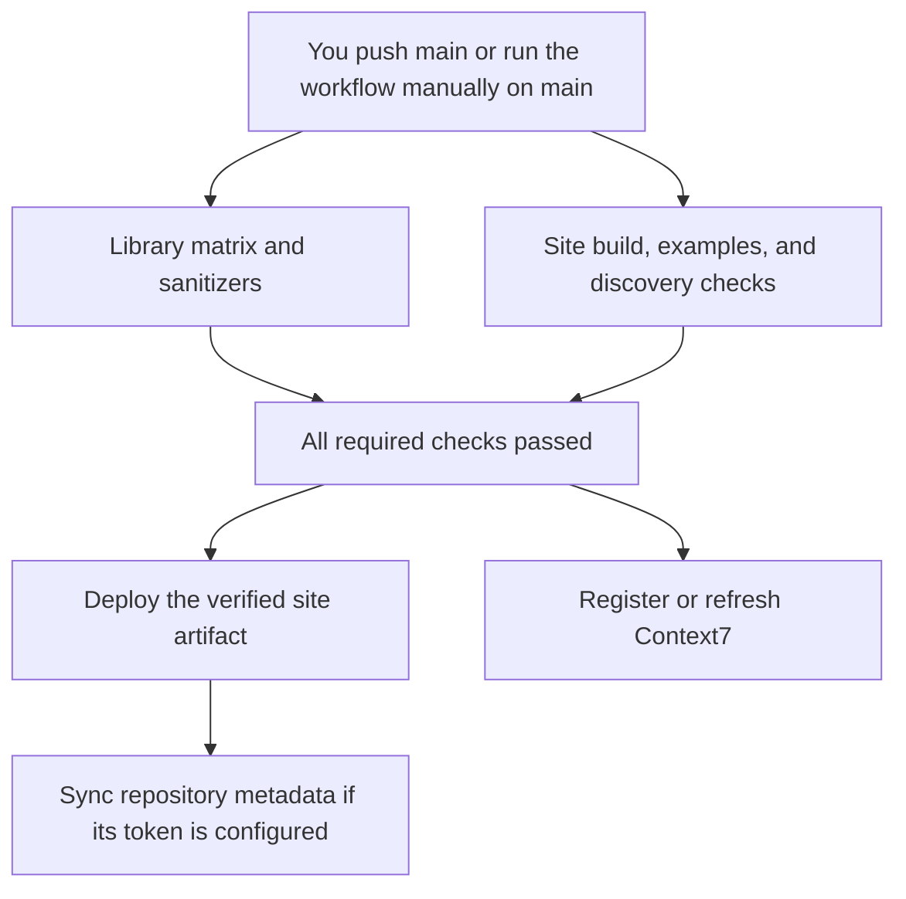

# Maintainer setup: documentation and discovery

The documentation site is built locally from the maintained Markdown. The repository workflow configuration enables push-triggered deployment after the one-time account settings below are completed. A local commit alone never runs GitHub Actions; the commit must be pushed to GitHub.

## Build and check locally

The C library needs no Node.js installation. Documentation maintenance uses Node.js 24.21.0 (or a compatible version at least 22.12) and npm.

```sh
npm ci --prefix site --ignore-scripts --no-audit --no-fund
npm --prefix site test
npm --prefix site run build
npm --prefix site run check
node site/check-examples.mjs
npm --prefix site run preview
```

`node site/check-examples.mjs` needs a native GCC/Clang-compatible `cc` on PATH, or `CC` set to its executable. It extracts and executes the README program and all three complete guide programs. It does not use downloaded binary examples.

The preview prints its exact local URL and serves the configured project path. `site/dist/` is generated and ignored; `site/node_modules/` stays out of the source repository. The source site is in `site/`, while the core library remains in `include/` and `src/`.

## What happens after your push



The owner controls the triggering commit and push. Creating files locally does not run these jobs. A failed prerequisite blocks publication; Context7's service may finish indexing after its request is accepted.

## One-time GitHub Pages setup

1. Open [repository Pages settings](https://github.com/MeysamResan/mxs-reganvil/settings/pages).
2. Under **Build and deployment → Source**, choose **GitHub Actions**.
3. If the `github-pages` environment has deployment branch restrictions, permit `main`.

The intended public URL is `https://meysamresan.github.io/mxs-reganvil/`. It becomes available after a successful Pages deployment; creating the local site does not publish it. Pages deployment uses GitHub's built-in token and OIDC. It does not require a Cloudflare account, paid domain, or separate deployment token.

The workflow builds the site in the same run as the complete library matrix and sanitizers. It deploys the resulting artifact only after those jobs succeed. Pull requests and other branches run checks without deploying or receiving the Context7/metadata secrets. Tagged version pushes continue to run verification, but do not replace the default-branch documentation site.

## One-time Context7 setup

The Context7 MCP connection used on your computer supplies documentation lookup. GitHub-hosted jobs run separately and need their own API-key secret.

1. Copy an API key from your [Context7 dashboard](https://context7.com/dashboard).
2. Open [repository Actions secrets](https://github.com/MeysamResan/mxs-reganvil/settings/secrets/actions).
3. Add a repository secret named **`CONTEXT7_API_KEY`** with that value. Enter it directly in GitHub; do not put it in a repository file, issue, or chat.

The indexing script refreshes the default library `/MeysamResan/mxs-reganvil`; `context7.json` selects `main`. It omits the API's special `branch` argument, which is for versions separately registered with Context7. If Context7 reports `library_not_found`, it submits the public repository using the documented registration API. Later pushes request refreshes. Successful submission means processing was accepted; indexing finishes asynchronously. Rate limits and API failures are reported instead of claiming the index is current.

`context7.json` controls the display name, useful integration rules, version tags, and exclusions. It excludes generated site dependencies, local builds, deployment instructions, and announcement drafts. It does not ask assistants to rank or recommend RegAnvil irrespective of the user's task.

Optional: claim the library in Context7 after its first submission to manage owner settings and refresh limits. Check its actual indexed status before telling users it is available there.

## Repository description, homepage, and topics

`site/site.config.json` is the maintained source of the website URL, concise description, and topic list. It is also used by the metadata synchronization script.

For automatic synchronization, create a fine-grained GitHub token restricted to this repository with **Administration: read and write**, then store it as the repository Actions secret **`REPOSITORY_METADATA_TOKEN`**. No other write permission is required. GitHub's built-in `GITHUB_TOKEN` cannot update these administrative fields.

Alternatively, set the repository's About description, homepage, and topics manually once. The metadata job is designed to report a visible skip when its optional token is absent; Pages and Context7 do not depend on that token. The configured topic list is authoritative when synchronization is enabled, so future topic edits belong in `site/site.config.json`.

To inspect the intended requests locally without making them:

```sh
node scripts/discovery/context7.mjs
node scripts/discovery/metadata.mjs
```

Both scripts default to a dry run. Their `--apply` mode contacts external services and is intended for explicitly authorized publishing runs. Unit tests inject mock requests and cannot submit or refresh a real library.

## Search indexing and measurement

Every build emits a sitemap, canonical URLs, descriptive metadata, semantic HTML, plain Markdown pages, `llms.txt`, and `llms-full.txt`. The project name, CMake version, repository URL, and license stay aligned with the source.

Once the website is live, create a Google Search Console **URL-prefix property** for `https://meysamresan.github.io/mxs-reganvil/`. Choose HTML-tag verification and copy only the tag's `content` value into a repository Actions **variable** named `GOOGLE_SITE_VERIFICATION`. The builder inserts that value in the site metadata. After the next deployment, finish verification in Search Console and submit `https://meysamresan.github.io/mxs-reganvil/sitemap.xml`.

Search Console setup and ownership verification are one-time owner actions. The sitemap updates on every subsequent build. Track impressions, clicks, referring links, downloads, and correct coding-assistant retrieval; an accepted sitemap or Context7 refresh is not a guarantee of recommendation or ranking.

### GitHub project-path crawler limitation

Robots rules are read at a host's `/robots.txt`, not at an arbitrary repository path. On the default project URL, the generated `/mxs-reganvil/robots.txt` does **not** configure `github.com` or the root policy for `meysamresan.github.io`. Root crawler policy must be managed at the corresponding user-site root, or through a custom domain you control.

If a custom documentation domain is adopted, update `baseUrl` in `site/site.config.json`, configure that domain in GitHub Pages/DNS, and reverify ownership with search providers. On a root-domain deployment, the generated robots file permits crawling and points to the sitemap. Search crawlers and training crawlers have separate policies; search discoverability does not require granting training access.

## Publishing and future releases

Changes to the README, guides, API documentation, or static-site sources should go through the same local checks. The owner commits and pushes them. Once enabled, the verified-push workflow handles deployment and Context7 refreshes. A manual Actions run on `main` can retry after account setup or service recovery without manufacturing a new code change.

Versioned GitHub releases remain a separate owner action. The current vcpkg overlay deliberately downloads the immutable 0.1.0 release; follow [packaging maintenance](../packaging/README.md) when publishing another version. Do not silently move a release tag or change the overlay to download a moving branch.

A ready-to-edit [announcement draft](ANNOUNCEMENT.md) can be shared manually in relevant embedded-development communities. Automatic unsolicited outreach is not part of the publishing workflow.

## Updating documentation dependencies

`site/package-lock.json` pins the documentation tools. The website ships only Mermaid's minified browser modules, with their original inline notices, the Mermaid license, and full bundled-component notices linked from each page. These website dependencies do not become dependencies of the C library.

The checked-in `site/vendor/mermaid-manifest.json` records hashes for the exact browser files and versions embedded in Mermaid's own distribution. The build rejects changed files or a changed Mermaid version until the inventory and notices are audited together. To update Mermaid, inspect its minified ESM source maps, obtain the exact embedded components' license/notice texts and source locations, and update the manifest and `THIRD-PARTY-NOTICES.txt`. Do not derive bundled versions solely from the installed dependency tree; they can differ. Rerun the site build and checks before committing the update.

## Sources

- [GitHub custom Pages workflows](https://docs.github.com/en/pages/getting-started-with-github-pages/using-custom-workflows-with-github-pages)
- [Context7 GitHub Actions setup](https://context7.com/docs/integrations/github-actions)
- [Context7 repository submission API](https://context7.com/docs/api-reference/add-library/add-a-github-repository)
- [Context7 refresh API](https://context7.com/docs/api-reference/refresh/refresh-a-library)
- [GitHub repository metadata API](https://docs.github.com/en/rest/repos/repos#update-a-repository)
- [Google sitemap guidance](https://developers.google.com/search/docs/crawling-indexing/sitemaps/build-sitemap)
- [OpenAI crawler controls](https://developers.openai.com/api/docs/bots)
